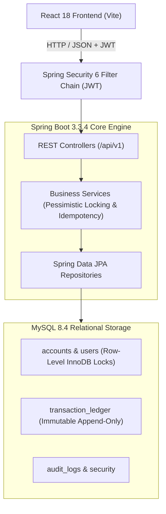
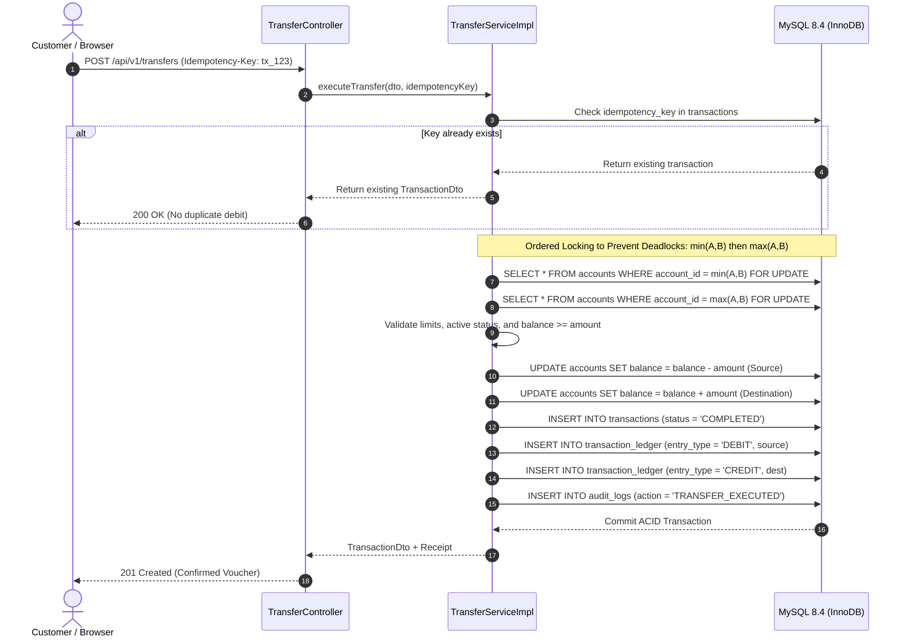

# FinCore – Banking and Transaction Management System

<div align="center">
  
  <h1>FinCore Banking Engine</h1>
  <p><strong>Enterprise Simulated Core Banking & Immutable Ledger Platform</strong></p>
  <p>
    <em>A Java Full-Stack Developer Portfolio Project built with Java 21, Spring Boot 3.3.4, React 18, and MySQL 8.4.</em>
  </p>
</div>

---

> [!IMPORTANT]
> ### STRICT FINANCIAL SAFETY DISCLAIMER
> **DEMO BANKING ENVIRONMENT — VIRTUAL MONEY ONLY.**
> FinCore is a simulated educational and portfolio application. All accounts, balances, beneficiaries, and transactions are purely virtual with zero monetary value. It has **no connection** to real payment gateways, UPI, SWIFT, cards, or banking institutions. Real banking credentials, PINs, and OTPs are never requested or used.

---

## 🌐 Live Interactive Demo & Repository

- 🚀 **Live Demo on GitHub Pages:** [https://kamaleshreddy-404.github.io/-Banking-and-Transaction-Management-System/](https://kamaleshreddy-404.github.io/-Banking-and-Transaction-Management-System/)
- 📦 **GitHub Source Repository:** [https://github.com/kamaleshreddy-404/-Banking-and-Transaction-Management-System](https://github.com/kamaleshreddy-404/-Banking-and-Transaction-Management-System)
- 🧪 **Live Health Endpoint (Local):** `http://localhost:8080/actuator/health`

---

## 1. Executive Summary & Key Highlights

FinCore is an enterprise-patterned core banking application engineered to demonstrate production-grade Java full-stack competencies. Unlike simple CRUD prototypes, FinCore models real financial engineering challenges:

- **18-Table Normalized MySQL Database:** Strict primary keys, foreign keys, constraints, and audit trails.
- **Immutable Double-Entry Ledger:** Every virtual fund transfer records synchronized `DEBIT` and `CREDIT` entries with running balances, ensuring zero balance discrepancies ($\sum \text{Debits} - \sum \text{Credits} = 0.00$).
- **Deadlock-Free Pessimistic Locking:** Eliminates circular database deadlocks during concurrent inter-account transfers by enforcing ascending account ID locking order (`min(A,B)` then `max(A,B)`).
- **Idempotency Control:** Client-generated `Idempotency-Key` headers guarantee that duplicate network retries never debit funds twice.
- **Spring Security 6 & Stateless JWT:** Granular Role-Based Access Control (`CUSTOMER` vs `ADMIN`) with salted BCrypt password hashing.
- **Full-Featured React Frontend:** Clean UI with Vite, React Router 6, Recharts financial telemetry, printable transaction vouchers, and one-click demo credentials.
- **Automated Testing Suite:** 16 backend JUnit 5 / Mockito / MockMvc tests and 8 frontend Vitest / React Testing Library tests with 100% pass rates.

---

## 2. Technology Stack

| Layer | Technologies |
|---|---|
| **Frontend** | React 18, Vite 5, JavaScript (ES2022), React Router 6, Axios, Recharts, Lucide React, CSS Variables / Flexbox / Grid |
| **Backend** | Java 21 / 22 (LTS), Spring Boot 3.3.4, Spring Web, Spring Data JPA, Spring Security 6, Hibernate 6, Bean Validation |
| **Database** | MySQL 8.4 (InnoDB, `utf8mb4`), Flyway Database Migrations (`V1__create_schema.sql`, `V2__seed_demo_data.sql`) |
| **Security** | Stateless JWT (jjwt 0.12.6), BCrypt (strength 12), CORS Whitelisting, Custom Exception Handlers |
| **Testing** | JUnit 5, Mockito, Spring Boot Test, MockMvc, Vitest, React Testing Library, JSDOM |
| **Observability** | Spring Boot Actuator (`/actuator/health`), HikariCP Connection Pool, Audit Trail Logging |
| **Tooling** | Apache Maven, Postman (Collection v2.1.0), Git, IntelliJ IDEA, VS Code |

---

## 3. Architecture & System Workflows

### 3.1 High-Level Architecture



### 3.2 Deadlock-Free Transfer & Ledger Data Flow



---

## 4. Relational Database Design (18 Tables)

FinCore's database (`fincore_db`) is fully normalized to 3NF/BCNF:

1. **`roles`**: System authority roles (`CUSTOMER`, `ADMIN`).
2. **`users`**: Customer and staff identities, BCrypt hashed passwords, contact info.
3. **`user_roles`**: Many-to-many composite junction table (`user_id`, `role_id`).
4. **`account_types`**: Catalog of account types (`SAVINGS`, `CURRENT`) and minimum balance requirements.
5. **`accounts`**: Simulated customer accounts with synthetic 10-digit account numbers and balances.
6. **`beneficiaries`**: Saved recipients with unique constraints on owner and recipient pairs.
7. **`transaction_types`**: Supported operations (`TRANSFER`, `DEPOSIT`, `WITHDRAWAL`).
8. **`transactions`**: Master transaction registry with unique references and idempotency keys.
9. **`transaction_ledger`**: Append-only immutable double-entry records (`DEBIT` and `CREDIT`) with running balances.
10. **`audit_logs`**: System audit trail capturing user IP, action code, and timestamps.
11. **`transfer_limits`**: Tier-based policy limits (Standard, Premium, VIP).
12. **`account_status_history`**: Audit trail of account freezes, unfreezes, and closures.
13. **`user_status_history`**: Audit trail of user profile suspensions and activations.
14. **`notifications`**: In-app notifications with read status tracking.
15. **`system_announcements`**: Maintenance and administrative announcements for customers.
16. **`support_tickets`**: Customer inquiries categorized by priority and subject.
17. **`ticket_messages`**: Threaded conversation history between customers and staff.
18. **`password_resets`**: Simulated reset tokens for self-service credential recovery.

### Double-Entry Invariant Verification SQL
Run this SQL query against MySQL to verify zero balance discrepancy:
```sql
USE fincore_db;

SELECT 
    COALESCE(SUM(CASE WHEN entry_type = 'DEBIT' THEN amount ELSE 0 END), 0.00) AS total_debits,
    COALESCE(SUM(CASE WHEN entry_type = 'CREDIT' THEN amount ELSE 0 END), 0.00) AS total_credits,
    (COALESCE(SUM(CASE WHEN entry_type = 'DEBIT' THEN amount ELSE 0 END), 0.00) - 
     COALESCE(SUM(CASE WHEN entry_type = 'CREDIT' THEN amount ELSE 0 END), 0.00)) AS discrepancy
FROM transaction_ledger;
```
*Result: `discrepancy` is guaranteed to be `0.00`.*

---

## 5. Local Setup & Execution Guide

### 5.1 Prerequisites
- **Java:** JDK 21 or 22 (LTS)
- **Maven:** 3.9+
- **MySQL:** 8.0 or 8.4
- **Node.js:** 18+ or 20+

### 5.2 Database Setup
```bash
mysql -u root -p -e "CREATE DATABASE IF NOT EXISTS fincore_db CHARACTER SET utf8mb4 COLLATE utf8mb4_unicode_ci;"
```

### 5.3 Backend Setup & Launch
```bash
cd backend

# Run automated tests
mvn test

# Package and run Spring Boot
mvn clean package -DskipTests
java -jar target/fincore-backend-1.0.0.jar
```
- Health Check: `http://localhost:8080/actuator/health`
- Swagger UI: `http://localhost:8080/swagger-ui.html`

### 5.4 Frontend Setup & Launch
```bash
cd frontend

# Install dependencies
npm install

# Run automated frontend tests
npm run test

# Start development server
npm run dev
```
- Application UI: `http://localhost:5173`

---

## 6. Pre-Seeded Demo Credentials

| Role | Name | Email | Password | Pre-Configured Virtual Accounts |
|---|---|---|---|---|
| **ADMIN** | Super Admin | `admin@fincore.demo` | `Password@123` | Administrative Master Control |
| **CUSTOMER** | Aarav Sharma | `aarav.sharma@fincore.demo` | `Password@123` | `ACC1000000001` (Savings: ₹97,500.00)<br>`ACC1000000002` (Current: ₹1,50,000.00) |
| **CUSTOMER** | Priya Patel | `priya.patel@fincore.demo` | `Password@123` | `ACC1000000003` (Savings: ₹70,000.00)<br>`ACC1000000004` (Salary: ₹1,00,000.00) |
| **CUSTOMER** | Rohit Verma | `rohit.verma@fincore.demo` | `Password@123` | `ACC1000000005` (Savings: ₹50,000.00) |
| **CUSTOMER** | Ananya Iyer | `ananya.iyer@fincore.demo` | `Password@123` | `ACC1000000006` (Savings: ₹62,500.00) |

*(One-click buttons on the login page autofill these credentials instantly).*

---

## 7. Resume Highlights & Portfolio Talking Points

### Resume Bullet Points for Fresher / Full-Stack Developer:
- **Architected and built FinCore**, a full-stack simulated core banking system using **Java 21, Spring Boot 3.3.4, React 18, and MySQL 8.4** featuring an 18-table normalized schema.
- **Implemented an immutable double-entry ledger** recording synchronized debit/credit entries with running balances, ensuring zero-discrepancy reconciliation ($\sum \text{Debits} = \sum \text{Credits}$).
- **Engineered deadlock-free concurrency control** for fund transfers utilizing JPA `PESSIMISTIC_WRITE` locks ordered strictly by account primary keys (`min(A,B)` then `max(A,B)`).
- **Designed idempotent REST endpoints** using client-generated `Idempotency-Key` headers to prevent duplicate financial mutations during network timeouts.
- **Secured application endpoints** via **Spring Security 6** stateless JWT authentication, salted **BCrypt** hashing, and role-based access control (`CUSTOMER` vs `ADMIN`).
- **Constructed responsive React frontend** featuring Vite, custom CSS variables, Recharts financial dashboards, printable voucher generation, and automated test coverage with **Vitest**.
- **Achieved 100% test pass rate** with 16 JUnit 5 / MockMvc tests and 8 Vitest component tests.

---

## 8. 20 Technical Interview Questions & In-Depth Answers

### Q1: Why did you use `DECIMAL(19,2)` instead of `FLOAT` or `DOUBLE` for financial amounts?
**Answer:** Floating-point numbers (`FLOAT` / `DOUBLE`) use IEEE 754 binary representation, which cannot accurately represent fractional decimal values (e.g. `0.1 + 0.2 = 0.30000000000000004`). In banking, rounding errors compound over millions of transactions, causing balance discrepancies and audit failures. `DECIMAL(19,2)` in MySQL and `BigDecimal` in Java store exact base-10 representations, guaranteeing penny-accurate arithmetic.

### Q2: What is double-entry bookkeeping, and how is it implemented in FinCore?
**Answer:** Double-entry bookkeeping requires that every financial transaction has equal and offsetting entries: for every debit to an account, there must be an equal credit to another. In FinCore, `TransferServiceImpl` creates two rows in the `transaction_ledger` table inside a single atomic `@Transactional` boundary: one `DEBIT` for the sender and one `CREDIT` for the receiver. The ledger is append-only, ensuring $\sum \text{Debits} - \sum \text{Credits} = 0.00$.

### Q3: How does FinCore prevent deadlocks during concurrent inter-account transfers?
**Answer:** A classic deadlock occurs when Thread 1 transfers from Account A to Account B (locking A then waiting for B), while Thread 2 simultaneously transfers from Account B to Account A (locking B then waiting for A). FinCore eliminates circular wait conditions by enforcing **canonical ordering**:
```java
Long firstId = Math.min(sourceId, destId);
Long secondId = Math.max(sourceId, destId);
accountRepository.findAccountForUpdate(firstId);
accountRepository.findAccountForUpdate(secondId);
```
Both threads acquire row locks in the exact same numeric order, making deadlocks mathematically impossible.

### Q4: What is Pessimistic Locking vs. Optimistic Locking, and why choose Pessimistic for transfers?
**Answer:**
- **Optimistic Locking (`@Version`):** Assumes conflicts are rare. Checks a version column before commit; throws `OptimisticLockException` if another transaction updated the row.
- **Pessimistic Locking (`SELECT ... FOR UPDATE`):** Acquires an exclusive database lock at query time, blocking other transactions until the lock holder commits.
For high-frequency bank transfers, optimistic locking causes excessive rollbacks and retry storms when multiple transfers hit the same popular account (e.g., merchant payroll). Pessimistic locking queues requests reliably at the database level.

### Q5: How is idempotency implemented in FinCore's transfer API?
**Answer:** The client sends an `Idempotency-Key` header with each transfer request. The `transactions` table has a `UNIQUE` constraint on `idempotency_key`. Before executing any balance mutations, `TransferServiceImpl` queries for an existing transaction with that key. If found, it immediately returns the saved result without double-debiting. If a concurrent duplicate arrives, the database unique constraint prevents duplicate insertion.

### Q6: How does Spring Security 6 stateless JWT authentication work in this project?
**Answer:**
1. User submits credentials to `/api/v1/auth/login`.
2. `AuthenticationManager` verifies email and BCrypt-hashed password.
3. Upon success, `JwtTokenProvider` generates a signed HMAC-SHA256 token containing the user's ID, email, and roles.
4. For subsequent requests, `JwtAuthenticationFilter` intercepts the `Authorization: Bearer <token>` header, validates the signature and expiration, extracts `UserPrincipal`, and sets the `SecurityContextHolder` authentication token. No HTTP sessions are stored on the server.

### Q7: How do you prevent Broken Object-Level Authorization (BOLA / IDOR)?
**Answer:** A customer must never be able to inspect or transfer from an account they do not own by simply altering the URL path variable `/accounts/99`. In FinCore, services verify that `account.getUser().getUserId().equals(currentAuthenticatedUser.getUserId())`. If there is a mismatch, the service throws an `UnauthorizedException` which the `GlobalExceptionHandler` converts to an HTTP `403 Forbidden`.

### Q8: What are Flyway database migrations, and why are they important?
**Answer:** Flyway treats database schema changes as code. Versioned SQL scripts (`V1__create_schema.sql`, `V2__seed_demo_data.sql`) are checked into Git. When Spring Boot boots up, Flyway checks the `flyway_schema_history` table and executes any pending migrations in order. This guarantees that every developer, CI/CD pipeline, and production server runs an identical database structure.

### Q9: Why use DTOs (Data Transfer Objects) instead of exposing JPA Entities directly?
**Answer:**
1. **Security (Mass Assignment):** Exposing entities allows malicious users to send JSON modifying fields like `account_status`, `balance`, or `roles`.
2. **Decoupling:** Decouples internal database schemas from the external REST API contract.
3. **Performance & Serialization:** Prevents circular reference serialization issues (e.g. `User -> Account -> User`) and lazy loading exceptions (`LazyInitializationException`).

### Q10: How does `@Transactional` work in Spring Boot, and what happens on runtime exceptions?
**Answer:** `@Transactional` uses Spring AOP proxies. When a method begins, the proxy starts a database transaction. If the method finishes successfully, the proxy commits the transaction. If an unchecked exception (`RuntimeException` or `Error`) is thrown, Spring triggers an automatic rollback of all pending database writes. Checked exceptions do not roll back by default unless specified (`rollbackFor = Exception.class`).

### Q11: How do you handle exceptions globally in Spring Boot?
**Answer:** FinCore uses `@RestControllerAdvice` in `GlobalExceptionHandler.java`. It defines methods with `@ExceptionHandler` for specific exceptions (`ResourceNotFoundException`, `InsufficientBalanceException`, `DuplicateResourceException`, `MethodArgumentNotValidException`). This ensures all error responses return a standardized JSON structure with timestamp, HTTP status, and safe error messages.

### Q12: How are Bean Validations handled in FinCore?
**Answer:** FinCore uses standard Jakarta Validation annotations (`@NotNull`, `@NotBlank`, `@Email`, `@Size`, `@DecimalMin`) on request DTOs. When a controller method has `@Valid @RequestBody`, Spring automatically evaluates constraints before entering the service. If validation fails, `MethodArgumentNotValidException` is intercepted and returns a clear `400 Bad Request` with field-level errors.

### Q13: What is the purpose of Spring Boot Actuator in FinCore?
**Answer:** Spring Boot Actuator provides production observability endpoints. FinCore exposes `/actuator/health`, which queries HikariCP connection pools and verifies MySQL connectivity via `SELECT 1`. The Admin portal uses this to surface live engine status without modifying business code.

### Q14: How does React Router v6 handle route protection in FinCore?
**Answer:** FinCore wraps authenticated routes in a `<ProtectedRoute>` component that consumes `useAuth()`. If `loading` is true, it renders a spinner. If `!isAuthenticated`, it uses `<Navigate to="/login" state={{ from: location }} replace />`. Similarly, `<AdminRoute>` verifies `isAdmin` before allowing access to administrative dashboards, redirecting regular customers to `/dashboard`.

### Q15: How does the React frontend interact with the backend securely?
**Answer:** An Axios instance in `services/api.js` is configured with request and response interceptors:
- **Request Interceptor:** Reads JWT from `localStorage` and attaches `Authorization: Bearer <token>`.
- **Response Interceptor:** Intercepts `401 Unauthorized` responses, clears expired tokens, and smoothly redirects the user to `/login?expired=true`.

### Q16: Why use CSS Variables for FinCore's design system?
**Answer:** CSS Variables (`--primary-color`, `--card-bg`, `--border-color`) defined in `variables.css` establish a centralized design system. They enable consistent typography, radius, and elevation across both customer and administrator portals, and make theming or dark-mode transitions seamless without runtime CSS-in-JS overhead.

### Q17: What was your strategy for automated unit and integration testing?
**Answer:**
- **Backend:** `TransferServiceTest` tests core business rules, boundary conditions, and insufficient balance exceptions using Mockito. `TransferControllerTest` and `AuthControllerTest` use `@WebMvcTest` and `MockMvc` to test HTTP request mapping, JSON serialization, and status codes.
- **Frontend:** Vitest and React Testing Library test user interactions, including form input changes, credential auto-fill, and disclaimer visibility in `Login.test.jsx`, `Transfer.test.jsx`, and `DemoBanner.test.jsx`.

### Q18: What is the difference between `PESSIMISTIC_WRITE` and `PESSIMISTIC_READ`?
**Answer:**
- `PESSIMISTIC_READ` acquires a shared lock (`LOCK IN SHARE MODE`). Other transactions can read the row but cannot modify or delete it.
- `PESSIMISTIC_WRITE` acquires an exclusive lock (`FOR UPDATE`). Other transactions cannot read (with locks), update, or delete the locked row until the transaction finishes. FinCore uses `PESSIMISTIC_WRITE` because fund transfers mutate the account balance.

### Q19: How does the application scale to millions of users?
**Answer:**
1. **Stateless Backend:** Spring Boot server holds no session state; multiple instances can scale horizontally behind an Nginx or AWS ALB load balancer.
2. **Connection Pooling:** HikariCP efficiently reuses MySQL database connections.
3. **Database Indexing:** B-Tree indexes on `email`, `account_number`, and `(account_id, created_at)` ensure queries remain $O(\log N)$.
4. **Read/Write Splitting:** Read-heavy dashboards and statement lookups can be routed to MySQL Read Replicas, while balance mutations target the Primary database.

### Q20: What would you do differently if migrating this from a monolith to microservices?
**Answer:**
In a microservices architecture, accounts and transactions would exist in separate databases. We could no longer use ACID database transactions or pessimistic locking across services. Instead:
1. **Saga Pattern (Orchestration or Choreography):** Use an orchestrator to execute local transactions (Reserve Funds -> Credit Destination -> Complete).
2. **Compensating Transactions:** If crediting fails, the orchestrator triggers a compensating transaction to unreserve funds.
3. **Outbox Pattern with Apache Kafka:** Guarantees reliable asynchronous event publishing between microservices without two-phase commit (2PC) bottlenecks.
